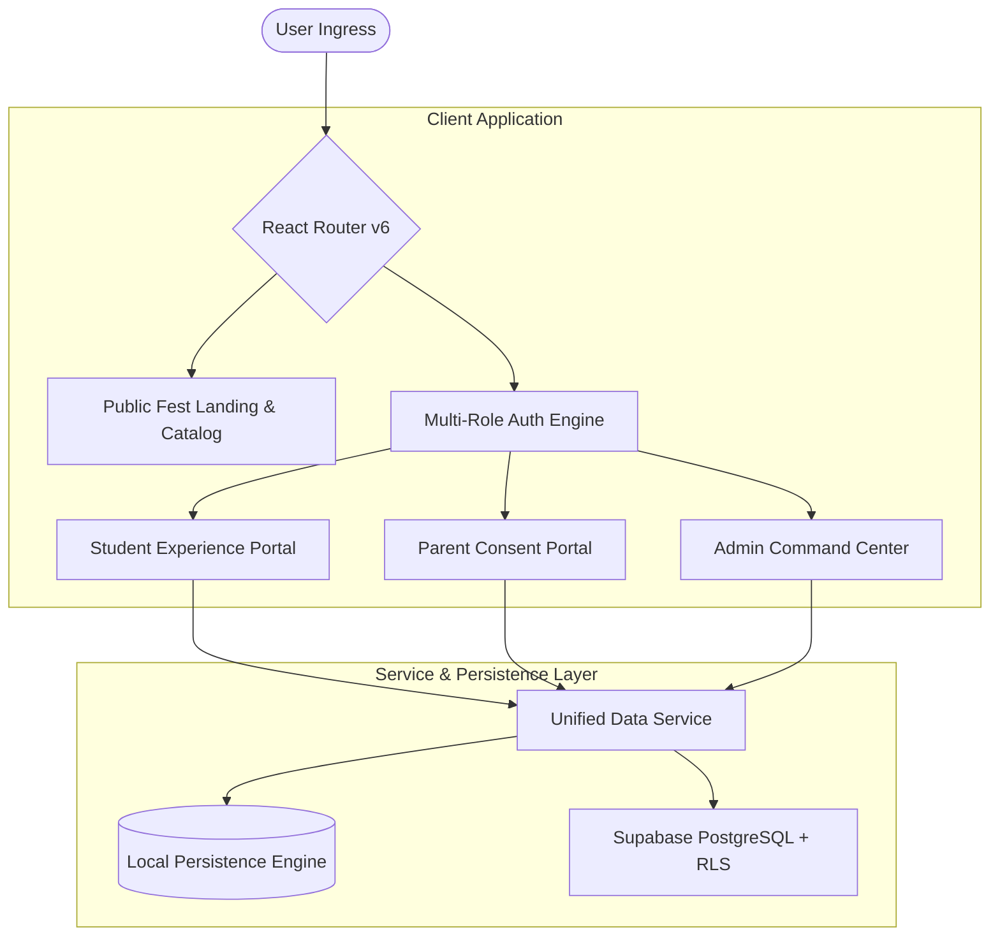

# FestFlow — Intelligent College Festival & Event Management Platform

<div align="center">


[](https://github.com/rahulguttedar03-debug/festflow/actions)
[](https://www.typescriptlang.org/)
[](https://react.dev/)
[](https://vitejs.dev/)
[](https://tailwindcss.com/)
[](https://opensource.org/licenses/MIT)

**"Every Campus Fest. One Connected Platform."**  
*A modern, commercial-grade SaaS platform engineered for university festivals, cultural summits, technical hackathons, competitions, workshops, and guest lectures.*

[Live Demo](#-quick-start) • [Architecture](#-architecture) • [Role Portals](#-role-portals) • [Supabase Setup](#-database-setup-supabase)

</div>

---

## 🌟 Executive Overview

**FestFlow** connects the three critical stakeholders of campus life into a unified, secure operating system:

1. **🛡️ Administrators & Faculty:** Full control over event publishing, seat capacity, parental consent requirements, applicant review, live QR check-ins, and Recharts analytics.
2. **🎓 Students:** Discover festivals, register with capacity safeguards, track calendar commitments without conflicts, access scannable QR passes, and download officially verified participation certificates.
3. **👨‍👩‍👦 Parents:** Stay informed of child campus participation, review and approve/decline overnight or excursion consent requests, and inspect verified attendance logs.

---

## 🏛️ Architecture & System Design



---

## 🚀 Key Features

### 1. 🎓 Student Experience
- **Smart Catalog & Filter:** Filter by Technical, Cultural, Competitions, Workshops, and Seminars.
- **Capacity & Deadline Protection:** Real-time seat meters, duplicate registration prevention, and deadline enforcement.
- **Parent Consent Workflow:** Flags overnight events (e.g. 24h Hackathons) as `Pending Parent Consent` until approved.
- **Dynamic QR Check-in Pass:** Instant vector QR pass generated for venue desk scanning.
- **Interactive Calendar & Timeline:** Avoid schedule conflicts with both calendar month and chronological timeline views.
- **Verified Certificates:** Automatically unlocks accredited certificates with tamper-proof validation codes and printable layouts.

### 2. 👨‍👩‍👦 Parent Portal
- **Child Authorization Badge:** Verified connection to enrolled child (`Alex Chen - CS2024-089`).
- **Interactive Consent Flow:** Full itinerary breakdown (departure/return times, venue, rules) with one-click **"Grant Permission"** or **"Decline Consent"**.
- **Attendance Transparency:** Read-only verified records logged by campus entry scanners.
- **Campus Bulletins:** Real-time priority notifications and announcements from the Dean of Student Affairs.

### 3. 🛡️ Administrator Command Center
- **Rich Event Studio:** Configure eligibility by department and year, seat quotas, parent consent rules, and certificate issuance.
- **Live Check-in Desk:** Fast scanner input allowing barcode or manual token entry to check in attendees.
- **Applicant Management:** Tabular review with search, approval/rejection, and **CSV export**.
- **Interactive Analytics:**
  - Registration & attendance velocity over time (`AreaChart`)
  - Domain distribution breakdown (`PieChart`)
  - Department participation benchmarks (`BarChart`)

---

## ⚡ Quick Start

### Prerequisites
- Node.js `v18.0.0` or higher
- npm or pnpm

### Installation
```bash
# Clone the repository
git clone https://github.com/rahulguttedar03-debug/festflow.git
cd festflow

# Install dependencies
npm install

# Start development server
npm run dev
```

Open [http://localhost:5173](http://localhost:5173) in your browser.

### Production Build
```bash
npm run build
```

---

## 🔑 Demo Personas (1-Click Switcher)

FestFlow features a built-in **Persona Switcher** in the top navigation bar for immediate evaluator access:

| Role | Demo Email | Password | Details |
| :--- | :--- | :--- | :--- |
| **Student** | `alex.chen@campusflow.edu` | `password123` | Alex Chen (3rd Year, Computer Science) |
| **Parent** | `chen.family@gmail.com` | `password123` | David Chen (Father of Alex Chen) |
| **Admin** | `admin@campusflow.edu` | `adminpassword123` | Dr. Robert Vance (Director of Student Affairs) |

---

## 🗄️ Database Setup (Supabase)

FestFlow includes dual persistence:
1. **Built-in Mock/Local Engine:** Zero-config out of the box with realistic seed data.
2. **Production Supabase Integration:**

### Steps to connect Supabase:
1. Copy `.env.example` to `.env`:
   ```bash
   cp .env.example .env
   ```
2. Add your project credentials:
   ```env
   VITE_SUPABASE_URL=https://your-project.supabase.co
   VITE_SUPABASE_ANON_KEY=your-anon-key
   ```
3. Run the migration script located at [`supabase/migrations/20261026000000_init_campusflow.sql`](supabase/migrations/20261026000000_init_campusflow.sql) in your Supabase SQL editor. It provisions all 9 tables with Row Level Security (RLS) policies.

---

## 📂 Project Structure

```
festflow/
├── .github/workflows/ci.yml       # Automated GitHub Actions build pipeline
├── supabase/migrations/           # Normalized PostgreSQL schema & RLS policies
├── src/
│   ├── components/
│   │   ├── charts/                # Recharts area, pie, and department bar charts
│   │   ├── events/                # Event card, detail modal, QR pass, certificate
│   │   ├── layout/                # Navbar, Sidebar, Footer, Theme toggle
│   │   └── notifications/         # Real-time alert dropdown
│   ├── contexts/                  # AuthContext & EventContext reactive stores
│   ├── hooks/                     # Custom dark/light theme hook
│   ├── lib/                       # Supabase client, mock database, formatting utilities
│   ├── pages/
│   │   ├── admin/                 # Administrator command center
│   │   ├── auth/                  # Student, Parent, and Admin login/registration
│   │   ├── landing/               # Public homepage and event catalog
│   │   ├── parent/                # Parent portal and consent workflows
│   │   └── student/               # Student dashboard, schedule, registrations
│   ├── routes/                    # React Router configuration
│   ├── types/                     # TypeScript data interfaces
│   ├── App.tsx                    # Root application component
│   └── main.tsx                   # Application bootstrap
├── package.json
├── tailwind.config.js
└── vite.config.ts
```

---

## 📄 License

This project is licensed under the MIT License - see the [LICENSE](LICENSE) file for details.
